

  <a href="https://samaelsama69.github.io/SamaelSama69/">
    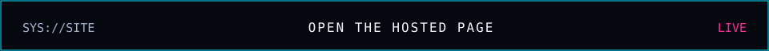
  </a>

  

  

  
  
  
  

  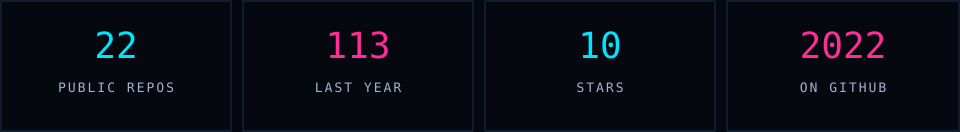

  

  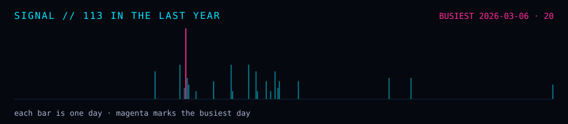

  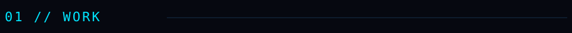

<table>
  <tr>
    <td width="50%">
      <a href="https://github.com/SamaelSama69/Enterprise_RAG_Project">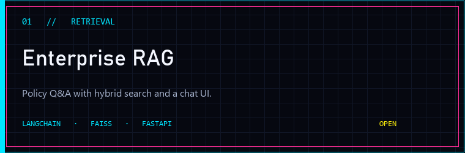</a>
    </td>
    <td width="50%">
      <a href="https://github.com/SamaelSama69/voice-agent">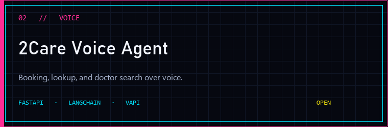</a>
    </td>
  </tr>
  <tr>
    <td width="50%">
      <a href="https://github.com/SamaelSama69/fabric-defect-detection">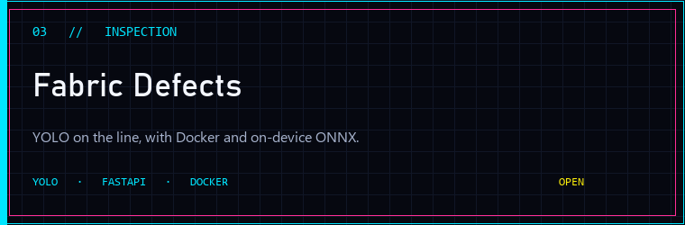</a>
    </td>
    <td width="50%">
      
    </td>
  </tr>
</table>

SQL analytics, credit-card fraud, customer churn, and bank segmentation are in the other repositories.

  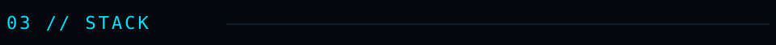

  

**Machine learning.** Pandas, NumPy, scikit-learn, Matplotlib, Seaborn, OpenCV, TensorFlow, PyTorch.

**LLM applications.** LangChain, FAISS, FastAPI, Streamlit.

  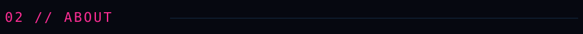

  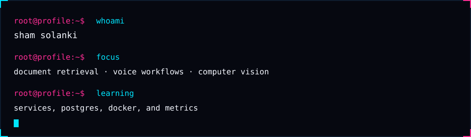

I build applied machine-learning systems in Python. Earlier work is classical ML and SQL analytics: classification, clustering, and business reporting. AWS is still at the basics.

  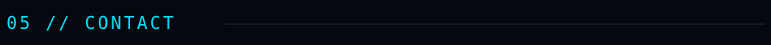

  
  
  
  

Open to internships and collaborations in data science and applied machine learning.

  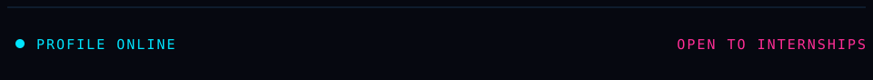

