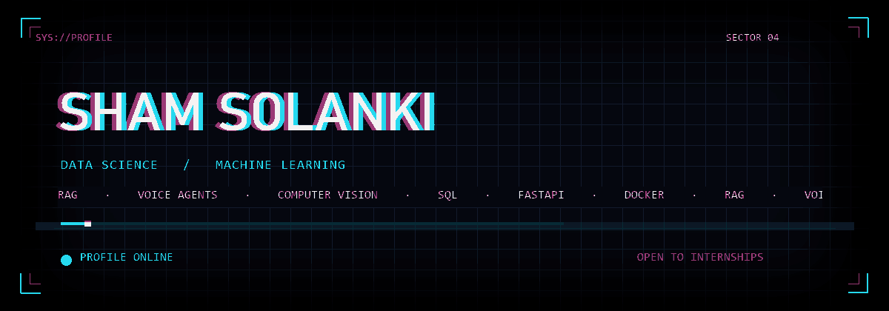
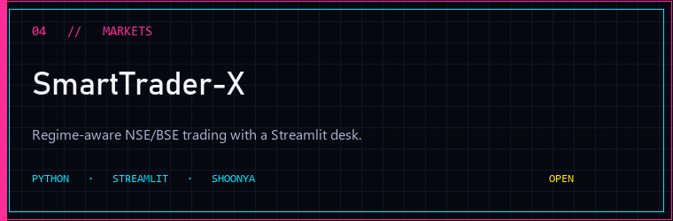

<p align="center">
  
</p>

<p align="center">
  
</p>

<p align="center">
  <a href="#work"></a>
  <a href="#about"></a>
  <a href="#stack"></a>
  <a href="#contact"></a>
</p>

## Work

<table>
  <tr>
    <td width="50%">
      <a href="https://github.com/SamaelSama69/Enterprise_RAG_Project"></a>
    </td>
    <td width="50%">
      <a href="https://github.com/SamaelSama69/voice-agent"></a>
    </td>
  </tr>
  <tr>
    <td width="50%">
      <a href="https://github.com/SamaelSama69/fabric-defect-detection"></a>
    </td>
    <td width="50%">
      <a href="https://github.com/SamaelSama69/SmartTrader-X"></a>
    </td>
  </tr>
</table>

SQL analytics, credit-card fraud, customer churn, and bank segmentation are in the other repositories.

## About

```text
root@profile:~$ whoami
sham solanki

root@profile:~$ focus
document retrieval · voice workflows · computer vision

root@profile:~$ learning
services, postgres, docker, and metrics
```

I build applied machine-learning systems in Python. Earlier work is classical ML and SQL analytics: classification, clustering, and business reporting. AWS is still at the basics.

## Stack

<p>
  
</p>

**Machine learning.** Pandas, NumPy, scikit-learn, Matplotlib, Seaborn, OpenCV, TensorFlow, PyTorch.

**LLM applications.** LangChain, FAISS, FastAPI, Streamlit.

## Signal

<p align="center">
  
  
</p>

<p align="center">
  
</p>

## Contact

<p align="center">
  <a href="mailto:shaamsolanki@gmail.com"></a>
  <a href="https://linkedin.com/in/sham-solanki"></a>
  <a href="https://www.mygreatlearning.com/eportfolio/sham-solanki"></a>
  <a href="https://github.com/SamaelSama69"></a>
</p>

<p align="center">Open to internships and collaborations in data science and applied machine learning.</p>
